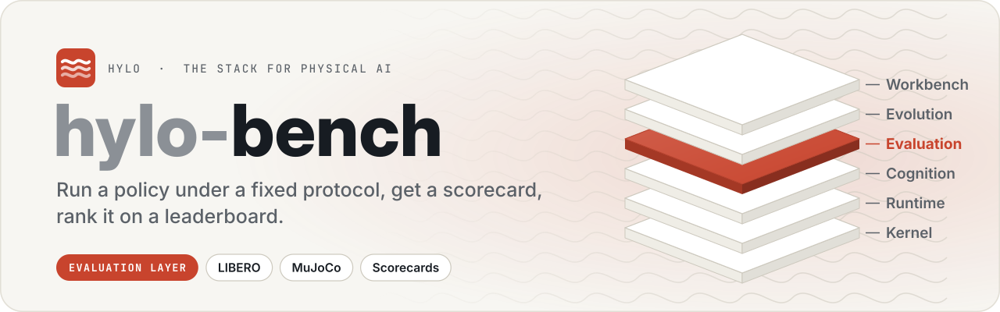
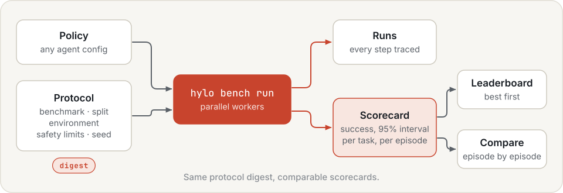
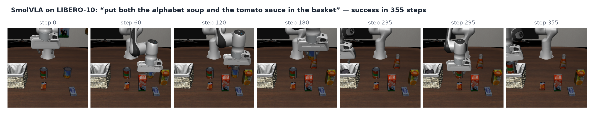
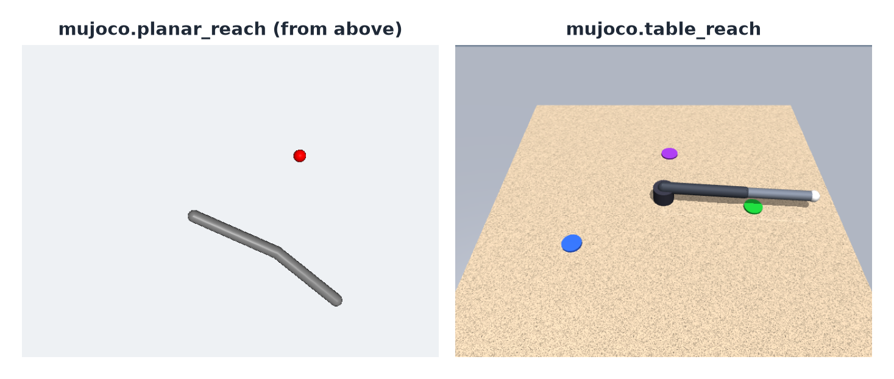
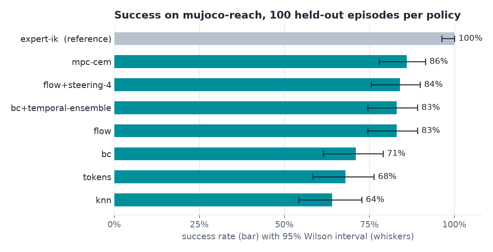
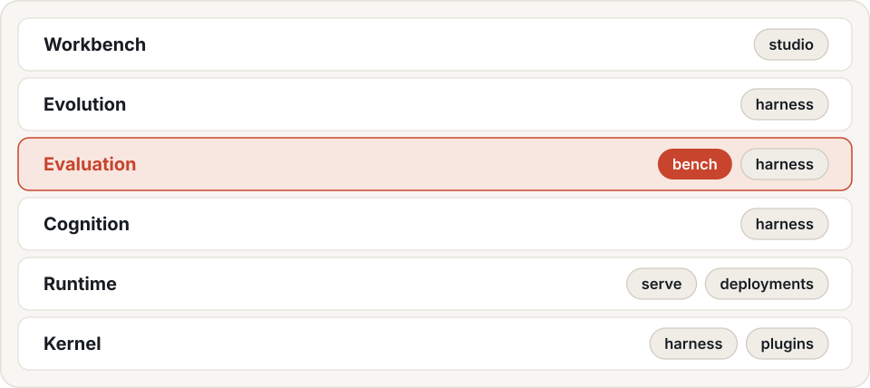

<p align="center">
  <picture>
    <source media="(prefers-color-scheme: dark)" srcset=".github/assets/banner-dark.svg">
    
  </picture>
</p>

<p align="center">
  <a href="LICENSE"></a>
  
  
  
</p>

<p align="center">
  <a href="https://hyloai.github.io/"><b>Website</b></a> ·
  <a href="https://hyloai.github.io/hylo-docs/"><b>Docs</b></a> ·
  <a href="https://hyloai.github.io/hylo-docs/getting-started/quickstart/"><b>Quickstart</b></a> ·
  <a href="https://github.com/HyloAI"><b>All repositories</b></a>
</p>

Part of [Hylo](https://hyloai.github.io/), the stack for physical AI. This repository is **Hylo Bench**, the
**evaluation** layer.

Benchmarking for Hylo: run a policy under a fixed **protocol** and get a **scorecard**; rank scorecards on
**leaderboards** and compare two of them episode by episode. Built on the harness's evaluation engine (hylo-eval).

<p align="center">
  <picture>
    <source media="(prefers-color-scheme: dark)" srcset=".github/assets/flow-dark.svg">
    
  </picture>
</p>

| Path | What it is |
|---|---|
| `packages/hylo-bench` | protocols (hylo.protocol/v0.1), `hylo bench`, leaderboards, pairwise comparison; scorecards are `core.scorecard` (hylo.scorecard/v0.1) |
| `adapters/hylo-env-libero` | LIBERO suites as benchmarks; the simulator runs in its own venv (`envs/libero`) |
| `adapters/hylo-env-mujoco` | MuJoCo planar-reach and table-reach environments and benchmarks |
| `envs/libero` | the LIBERO + LeRobot venv (`setup.sh`, CPU, no root); needs `scripts/install-osmesa-user.sh` |
| `examples/` | experiment configs and campaigns on these suites (MuJoCo reach / table, LIBERO-10), the reference-policy leaderboard (`policies/`), the RSI demo, the RSI scripts for LIBERO-10, the MuJoCo external demo |

## Suites

<p align="center">
  
</p>
<p align="center">
  
</p>

LIBERO-10 with SmolVLA (top, one recorded episode) and the two MuJoCo environments (bottom): planar reach, a
two-link arm and a target, and table reach, with language goals, occlusion memory and disturbances.

## Protocols

A protocol is everything about an evaluation except the policy: benchmark and split, environment, safety limits,
trace options, seed. Its digest covers only what is measured, so two scorecards with the same digest are
comparable. `hylo bench run` accepts execution-only overrides (`env.remote.*`, `--workers`) and refuses the rest.

| Protocol | Episodes | Notes |
|---|---|---|
| `mujoco-reach` | 100 | planar two-link arm, a fixed and a random target, 50 held-out seeds each |
| `libero-10` | 500 | official LIBERO protocol: all 50 init states of each task; includes the init states campaigns develop on |
| `libero-10-heldout` | 100 | RFC-0002 held-out init states 40-49 only: the fair test for policies improved by a campaign |

```bash
uv run hylo bench list
uv run hylo bench run mujoco-reach --policy '{"type": "baseline.planar_ik", "params": {"kp": 0.3}}' --name ik-0.3
uv run hylo bench run libero-10-heldout --policy examples/configs/libero10_steered.yaml --name smolvla-steered   # after envs/libero/setup.sh
uv run hylo bench leaderboard                 # every scorecard under scorecards/, per protocol, best first
uv run hylo bench compare scorecards/mujoco-reach/ik-0.3.json scorecards/mujoco-reach/other.json
```

<p align="center">
  
</p>
<p align="center"><sub>The reference-policy leaderboard on <code>mujoco-reach</code> (<code>examples/policies/</code>): reference policies trained from recorded runs against the expert IK controller, 100 held-out episodes each, 95% Wilson intervals.</sub></p>

Runs go to `runs/`, scorecards to `scorecards/<protocol>/<policy>.json` (`--out` changes the root).
`runs/` is this machine's run and artifact store once registered (`hylo store init runs`): configs reference
artifacts by id (`artifact:l10-trace-v2@54a1efadf00d34d8`, see `hylo store ls`), never by path, and `hylo store rm`
refuses to delete a run that an artifact or a campaign still refers to.
LIBERO configs and protocols name runtimes (`libero-sim` for the simulator, `lerobot` for policies), resolved from
this machine's execution profile (`hylo profile show`): `envs/libero/setup.sh` builds the venv, installs the harness
packages from a checkout next to this one (`HYLO_HARNESS`, default `../harness`) and registers both runtimes. So
they run from any directory, and where things are installed never changes an experiment's digest (RFC-0005).
`libero-10-heldout-realtime` scores the same episodes as a robot would run them (0.5 s per chunk, the arm keeps
moving): the gap to `libero-10-heldout` is what deployment costs a policy.

Documentation (hylo-docs, `uv run mkdocs serve -f docs/mkdocs.yml` from the workspace): [benchmarking](../docs/docs/benchmarking/index.md), [protocols](../docs/docs/benchmarking/protocols.md), [leaderboard](../docs/docs/benchmarking/leaderboard.md).

## The Hylo stack

<p align="center">
  <picture>
    <source media="(prefers-color-scheme: dark)" srcset=".github/assets/stack-dark.svg">
    
  </picture>
</p>

## License

Apache License 2.0 (see [LICENSE](LICENSE)). Copyright 2026 Hylo AI.
