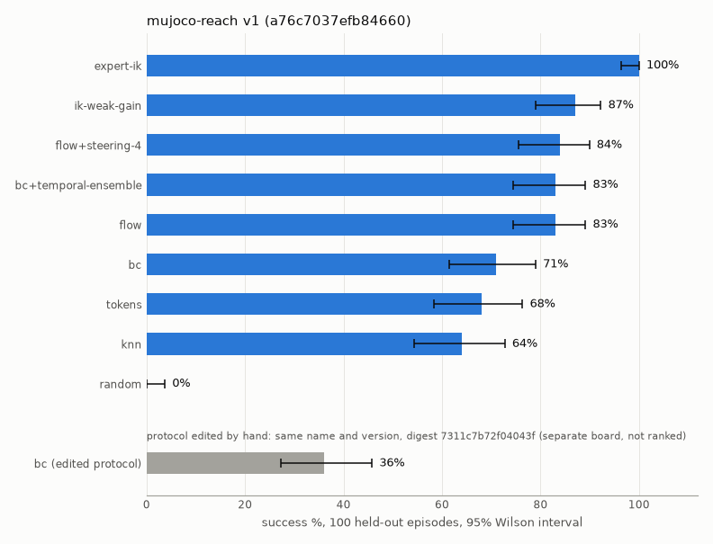
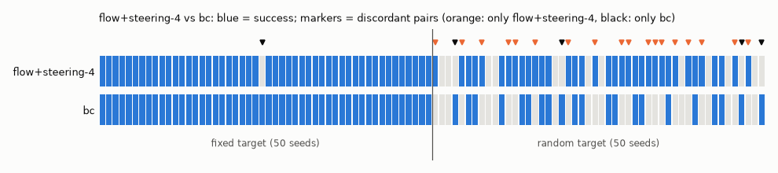
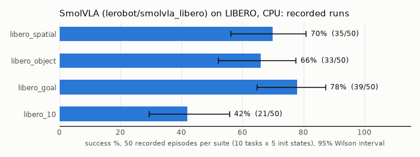
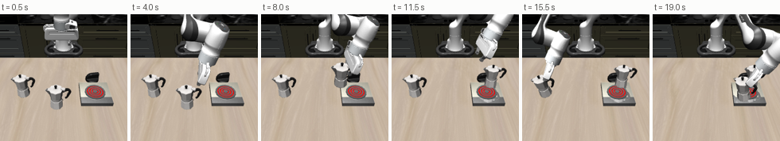

# Showcase

Four runnable examples of the evaluation layer, each with a measured result. Run them from the bench repository
root; each writes `result.json` (and figures) to `runs/examples/<slug>/` and prints a results table.

```bash
uv run python examples/showcase/01_leaderboard.py        [--quick] [--out DIR]
uv run python examples/showcase/02_pairwise.py           [--quick] [--out DIR]
uv run python examples/showcase/03_parallel_workers.py   [--quick] [--out DIR]
uv run python examples/showcase/04_libero_recorded.py    [--quick] [--out DIR] [--store DIR] [--run]
```

Measured on 2026-11-01, 128-core CPU, no GPU. All MuJoCo numbers are under the built-in `mujoco-reach` protocol
(100 held-out episodes, digest `a76c7037efb84660`) and are deterministic: a rerun gives the same numbers.

| Example | What it shows | Command | Measured result | Runtime |
|---|---|---|---|---|
| `01_leaderboard.py` | protocol -> scorecards -> leaderboard (table + PNG); a hand-edited protocol (same name and version, `safety.max_delta: 0.05`) gets another digest and is refused for ranking | `uv run python examples/showcase/01_leaderboard.py` | 9 agents ranked: expert-ik 100%, ik-weak-gain 87%, flow+steering-4 84%, bc+temporal-ensemble 83%, flow 83%, bc 71%, tokens 68%, knn 64%, random 0%. `bc` under the edited protocol (digest `7311c7b72f04043f`) scores 36%: it lands on a second board, `compare` raises "different protocols", and the same change passed as an override is refused; `workers` leaves the digest unchanged | 51 s (quick 17 s) |
| `02_pairwise.py` | episode-by-episode comparison: discordant pairs, one-sided exact McNemar, against overlapping Wilson intervals and an unpaired Fisher test | `uv run python examples/showcase/02_pairwise.py` | flow+steering-4 vs bc: 84 vs 71%, intervals overlap, discordant 18–5, McNemar p = 0.0053 (unpaired Fisher p = 0.021). bc+temporal-ensemble vs bc: 14–2, p = 0.0021. flow+steering-4 vs flow: 5–4, p = 0.50 (no evidence that steering helps flow). A/A control (bc scored twice): 0–0 | 28 s (quick 9 s) |
| `03_parallel_workers.py` | the same protocol with 1 / 4 / 16 workers: identical scorecards and identical action sequences (hashed from the traces); wall-clock time in-process and with a remote (out-of-process) agent | `uv run python examples/showcase/03_parallel_workers.py` | all 8 runs identical to their 1-worker reference (100/100 episodes, same actions). Workers are threads: in-process agents get slower, IK 2.0 -> 3.1 s (0.6x), MPC 43.5 -> 74.4 s (0.6x). MPC as a `remote` agent (one process per worker): 47.8 -> 12.4 s (4 workers, 3.9x) -> 4.8 s (16 workers, 9.9x), same 89% and same episodes as in-process | 206 s (quick 9 s, identity check only) |
| `04_libero_recorded.py` | SmolVLA (`lerobot/smolvla_libero`, CPU) on LIBERO from **recorded** runs (no re-simulation): success per suite with Wilson intervals, per-task outcomes, an episode strip; `--run` adds a 2-episode live check | `uv run python examples/showcase/04_libero_recorded.py --run` | recorded 2026-10-30, 50 episodes per suite (10 tasks x 5 validation init states): spatial 70% (56–81), object 66% (52–78), goal 78% (65–87), LIBERO-10 42% (29–56); pooled 64% (128/200). LIBERO-10 per task 0/5 to 4/5. Live check: 2/2 succeeded (82 and 109 steps; recorded 79 and 109) | 1 s (live check +40 to 70 s) |

## Figures









## Notes

- **Parallel workers.** The evaluator runs workers as threads. On MuJoCo reach a run is bound by Python in one
  process, so more threads make it slower. The `mujoco-reach` protocol's default `workers: 16` slows in-process
  agents down by about 1.5x. A speed-up needs the agent (or the simulator) out of process, as LIBERO configs do.
  Results do not change with the worker count either way.
- **LIBERO.** The numbers come from runs recorded with an earlier checkout, before the package rename (the
  manifests list `wc-*` packages). The script reads them from this machine's run store (`hylo profile show`) or
  from `--store`. They are 50-episode validation runs, not the official `libero-10` protocol (500 episodes).
  Live SmolVLA on CPU is not bit-reproducible: in an earlier live run of the same two episodes, one failed
  (280 steps).
- **Reference policies.** `01`, `02` and `03` retrain the policies they need (deterministic, cached under the output
  directory), using the same recipe as `examples/policies/compare.py`.
